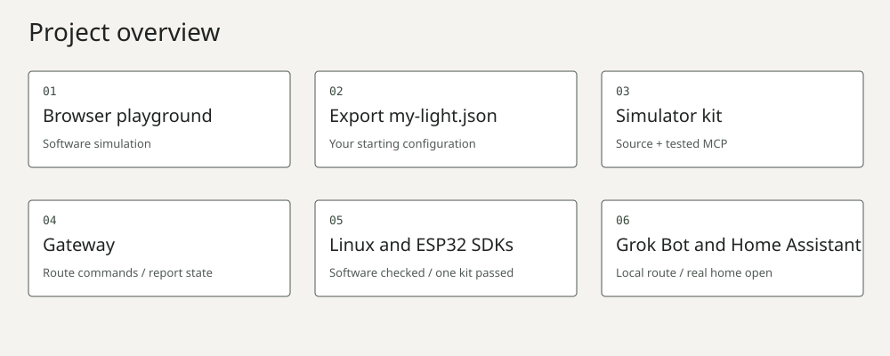
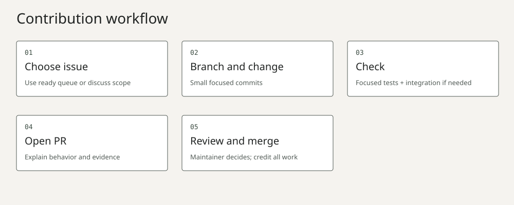

# Grok Gadgets


[](docs/public/support-matrix.md) [](LICENSE) [](https://github.com/adidshaft/grok-gadgets/actions) [](CONTRIBUTING.md)


<p align="center"><sub>Display lettering enhanced for readability.</sub></p>

**[Website](https://grokgadgets.org/)** · [Documentation](https://grokgadgets.org/docs.html) · [Roadmap](ROADMAP.md) · [Issues](https://github.com/adidshaft/grok-gadgets/issues) · **[Join r/GrokGadgets](https://www.reddit.com/r/GrokGadgets/)**

**Let your Grok Bot control lights, buttons and sensors you build. Open source.**

Status: one ESP32-S3/OLED kit passed USB and Wi-Fi acceptance; native Grok Bot MCP calls remain unverified
([project status](docs/public/support-matrix.md)).
Independent project, not affiliated with SpaceXSI.

Pick a path:

- **No hardware:** run the gateway's simulated light and rehearse the Grok Bot calls in
  [five minutes](https://github.com/adidshaft/grok-gadgets-gateway/blob/main/docs/first-success.md).
- **Raspberry Pi / Linux:** one install, ten lines of Python, one command with the
  [Linux SDK](https://github.com/adidshaft/grok-gadgets-linux-sdk#quickstart).
- **ESP32:** an Arduino sketch with the [ESP32 SDK](https://github.com/adidshaft/grok-gadgets-esp32-sdk#quickstart).

Already use Home Assistant? Check what it offers with the
[read-only probe](https://github.com/adidshaft/grok-gadgets-home-assistant).

The first physical experiment uses the [tested ESP32-S3 and OLED kit](docs/getting-started/experiment-kit.md). The owner's board passed USB and Wi-Fi acceptance. Follow the [repeatable kit guide](docs/getting-started/repeat-the-kit.md) to try the same setup. Another person's reproduction is still needed.

## Start here

| If you want to… | Open |
| --- | --- |
| See it work in five minutes, no hardware | [Gateway first success](https://github.com/adidshaft/grok-gadgets-gateway/blob/main/docs/first-success.md) |
| Play with a virtual light in your browser | [Browser playground](https://grokgadgets.org/#playground), then the [simulator kit](docs/getting-started/simulator-kit.md) |
| Build a Raspberry Pi or Linux gadget | [Linux SDK](https://github.com/adidshaft/grok-gadgets-linux-sdk) |
| Build an ESP32 gadget | [ESP32 SDK](https://github.com/adidshaft/grok-gadgets-esp32-sdk) |
| Run the local MCP gateway | [Gateway](https://github.com/adidshaft/grok-gadgets-gateway) |
| Check what Home Assistant offers (read-only) | [Home Assistant probe](https://github.com/adidshaft/grok-gadgets-home-assistant) |
| Compare cloud, Mac-to-Pi and remote MCP paths | [Hosting FAQ](docs/getting-started/hosting.md) |

## How the parts connect



Grok Bot normally runs on its cloud computer. This does not expose your home network.
On 12 October, the owner's Grok Bot ran approved gateway commands on the Mac. Gateway
logs matched the commands, including a display command to the physical OLED. This is
a verified **local command route**. Grok Bot did not call the gateway's MCP tools
natively. A Mac-to-Pi route through SSH remains an untested possibility.

The gateway's local `serve` works on loopback today. Packaged remote MCP and native
Grok Bot tool calls remain unverified. A tunnel adds reachability, not authentication.
See the [three-path hosting FAQ](docs/getting-started/hosting.md) before planning a connection.

## Community

Join [r/GrokGadgets](https://www.reddit.com/r/GrokGadgets/) to show what you built, ask
questions and share ideas. Follow the [community guidelines](community/guidelines.md) and the
[Code of Conduct](CODE_OF_CONDUCT.md); keep tokens and household details out of posts.
Bugs and proposals go to [GitHub Issues](https://github.com/adidshaft/grok-gadgets/issues).

## Contribute



Every repository has its own starter issues: see [ready issues](docs/contributing/ready-issues.md).
Branch from `dev` and open your PR into `dev`; `main` only holds tagged stable releases ([branches and releases](CONTRIBUTING.md#branches-and-releases)).
Then read the [contribution guide](CONTRIBUTING.md). Help: [support](SUPPORT.md). Security:
[security policy](SECURITY.md).

To build this website locally (Python 3.13, uv, Node.js 22+ and Git):

```sh
python3 scripts/dev.py setup
python3 scripts/dev.py check
python3 scripts/dev.py site
```

Open `http://127.0.0.1:4173/index.html`. With the four other repositories beside this one,
`scripts/check-all.py` runs the cross-repository integration.

## Support the project

Grok Gadgets is open source. If you’d like to support its development, you can send a
voluntary contribution to one of these addresses:

- **Ethereum (ETH):** `0xD571210016e5AB4206D27f24bE128916E1C91047`
- **Solana (SOL):** `D2jV1NkjuHHmvkuZ48Woc29v5NDeKLmHeLkUcN4fDg68`
- **Bitcoin (BTC):** `bc1qal92xr892akwxgqrnkjhld7ar04hlld06uqyq5`
- **ZEC (Shielded):** `u10hkzg65lgz6eq3arsylenag78jracfpguc3m4p6ptz8fkjlgxy6668yrjdgj2p704wp2f2wykrqv88tg9zu7fjuc9tk5s6vazvzmw5cvt5qkyzr32wqymesmcymja9zxpcwc6vcswa88yae023yj7jhypvn6n592t6z7nxqu4s59sdf9`

## License and affiliation

Apache-2.0; see [LICENSE](LICENSE) and [NOTICE](NOTICE). Grok Gadgets is an independent
open-source project. It is **not affiliated with, endorsed by or sponsored by SpaceXSI**, nor
with M5Stack or Home Assistant. The Grok mark shown on the website is not
covered by this project's license. Public history used reconstructed commit dates; see
[publication sanitization](docs/verification/publication-sanitization.md).
