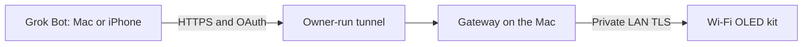

# Grok Gadgets


[](docs/public/support-matrix.md) [](LICENSE) [](https://github.com/adidshaft/grok-gadgets/actions) [](CONTRIBUTING.md)


<p align="center"><sub>Display lettering enhanced for readability.</sub></p>

**[Website](https://grokgadgets.org/)** · [Documentation](https://grokgadgets.org/docs.html) · [Roadmap](ROADMAP.md) · [Issues](https://github.com/adidshaft/grok-gadgets/issues) · **[Join r/GrokGadgets](https://www.reddit.com/r/GrokGadgets/)**

**Build a small Wi-Fi gadget for your Grok Bot. Open source.**

Alpha · one owner-tested kit · native Grok Bot calls from Mac and iPhone through a gateway on the owner's Mac.
See [project status](docs/public/support-matrix.md). Independent project, not affiliated with SpaceXSI.

## Choose a start

| Your task | Start here |
| --- | --- |
| Use a configured gadget | [Connect your Grok Bot](docs/getting-started/connect-grok-bot.md). An operator must first set up the kit, gateway and tunnel. |
| Build a gadget | [Tested OLED kit](docs/getting-started/repeat-the-kit.md), [ESP32 SDK](https://github.com/adidshaft/grok-gadgets-esp32-sdk) or [Linux SDK](https://github.com/adidshaft/grok-gadgets-linux-sdk) |
| Try without hardware | [Five-minute simulator guide](docs/getting-started/first-success.md) or [browser playground](https://grokgadgets.org/playground) |

[All documentation](docs/index.md) separates guides, reference, project status and test records.
Home Assistant users can start with the [read-only probe](https://github.com/adidshaft/grok-gadgets-home-assistant).

## How the parts connect

New here? Read [How it works](docs/getting-started/how-it-works.md): one page for builders, end users and the curious.



This route passed on the owner's setup. The Mac must stay awake and connected.
The [record](https://github.com/adidshaft/grok-gadgets/blob/main/docs/verification/daily-route-2026-10-13.md) covers one day. Another person's run remains open in [#185](https://github.com/adidshaft/grok-gadgets/issues/185).

**Mac-free route:** the gateway can also run on an always-on Linux server, so the Mac can sleep.
The owner's kit passed this on 13 October 2026 ([record](https://github.com/adidshaft/grok-gadgets/blob/main/docs/verification/mac-free-route-2026-10-13.md)). See the [Mac-free route guide](docs/getting-started/mac-free-route.md) and the [roadmap](ROADMAP.md).

## Community

Join [r/GrokGadgets](https://www.reddit.com/r/GrokGadgets/) to show what you built, ask
questions and share ideas. Follow the [community guidelines](community/guidelines.md) and the
[Code of Conduct](CODE_OF_CONDUCT.md); keep tokens and household details out of posts.
Bugs and proposals go to [GitHub Issues](https://github.com/adidshaft/grok-gadgets/issues).

## Contribute


Every repository has its own starter issues: see [ready issues](docs/contributing/ready-issues.md).
Branch from `dev` and open your PR into `dev`; `main` only holds tagged stable releases ([branches and releases](CONTRIBUTING.md#branches-and-releases)).
Then read the [contribution guide](CONTRIBUTING.md). Help: [support](SUPPORT.md). Security:
[security policy](SECURITY.md).

To build this website locally (Python 3.13, uv, Node.js 22+ and Git):

```sh
python3 scripts/dev.py setup
python3 scripts/dev.py check
python3 scripts/dev.py site
```

Open `http://127.0.0.1:4173/index.html`. With the four other repositories beside this one,
`scripts/check-all.py` runs the cross-repository integration.

## Support the project

Grok Gadgets is open source. If you’d like to support its development, you can send a
voluntary contribution to one of these addresses:

- **Ethereum (ETH):** `0xD571210016e5AB4206D27f24bE128916E1C91047`
- **Solana (SOL):** `D2jV1NkjuHHmvkuZ48Woc29v5NDeKLmHeLkUcN4fDg68`
- **Bitcoin (BTC):** `bc1qal92xr892akwxgqrnkjhld7ar04hlld06uqyq5`
- **ZEC (Shielded):** `u10hkzg65lgz6eq3arsylenag78jracfpguc3m4p6ptz8fkjlgxy6668yrjdgj2p704wp2f2wykrqv88tg9zu7fjuc9tk5s6vazvzmw5cvt5qkyzr32wqymesmcymja9zxpcwc6vcswa88yae023yj7jhypvn6n592t6z7nxqu4s59sdf9`

## License and affiliation

Apache-2.0; see [LICENSE](LICENSE) and [NOTICE](NOTICE). Grok Gadgets is an independent
open-source project. It is **not affiliated with, endorsed by or sponsored by SpaceXSI**, nor
with M5Stack or Home Assistant. The Grok mark shown on the website is not
covered by this project's license. Public history used reconstructed commit dates; see
[publication sanitization](https://github.com/adidshaft/grok-gadgets/blob/main/docs/verification/publication-sanitization.md).
