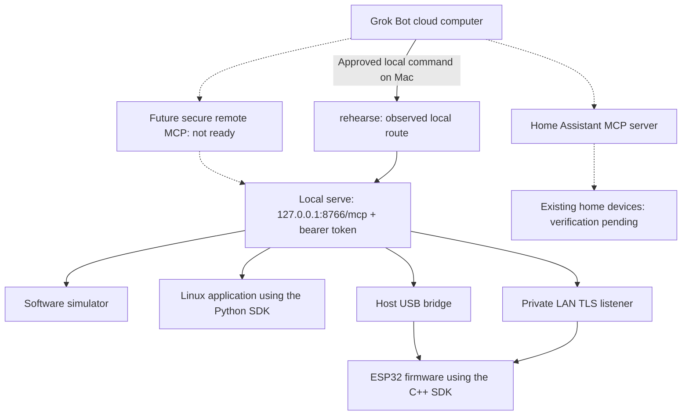
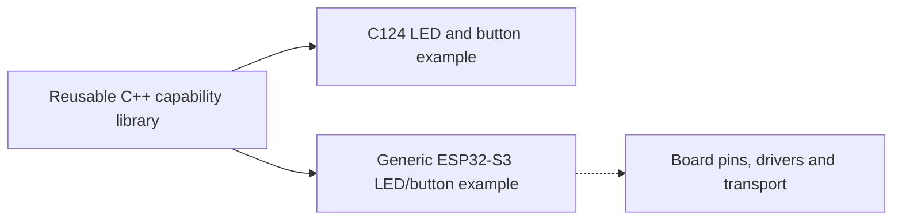

# Repository and device map

The project provides reusable gadget libraries for Grok Bot. The delivered ESP32-S3/OLED kit is the first physical experiment. The owner's kit passed USB and Wi-Fi acceptance. Approved local Grok Bot commands reached the gateway and showed text on the OLED. Native MCP calls and independent reproduction remain open. Retained C124 and generic examples are not the SDK boundary.

The gateway operator hosts the MCP server. SpaceXSI hosts Grok Bot. The website hosts neither. Read the [hosting FAQ](../getting-started/hosting.md).

| Repository | Responsibility |
| --- | --- |
| `grok-gadgets` | Website, shared docs, roadmap, community policies and integration checks |
| `grok-gadgets-gateway` | MCP tools, command routing, device protocol and simulator |
| `grok-gadgets-linux-sdk` | Python library and agent for computer-based gadgets |
| `grok-gadgets-esp32-sdk` | Reusable C++ library and board-specific firmware examples |
| `grok-gadgets-home-assistant` | Discovery diagnostics and setup guidance for Home Assistant's own MCP server |



Solid arrows describe implemented interfaces. The owner observed physical operation on one ESP32-S3/OLED kit over USB and Wi-Fi. The dotted remote gateway path still needs an accepted secure endpoint and native Grok Bot MCP calls. The private LAN TLS listener serves Wi-Fi devices; it is not a public Grok Bot endpoint. A tunnel adds reachability, not authentication. The dotted Home Assistant path needs its own client, endpoint and physical checks. Home Assistant does not need our gateway for its own MCP route.

## Separate manual Mac route

Grok Bot normally works on its cloud computer. Its internet connection does not expose your private LAN. **Execution on Local Computer** is a separate capability. If you enable it and approve a command, it can run that command on your Mac.

```text
Grok Bot → approved local command on Mac → SSH over home LAN → Pi
```

The owner's approved Mac commands reached the gateway and one OLED kit. The SSH extension to a Pi remains untested: it needs a reachable Pi and a working SSH setup. USB alone does not create that SSH route. Local commands are not a packaged native MCP integration. See the [hosting FAQ](../getting-started/hosting.md) for all three paths.

## Reusable core, separate board examples



The current ESP32 capability library has no board or serial dependency. `GrokGadgets.h` handles capabilities and bounded command results. `GrokCore.h` provides shared utilities. `C124.h` and the example application supply the retained reference board's hardware behavior. The delivered YD-ESP32-23 v1.3 kit uses a 1.3-inch SH1106 OLED at `0x3C`, GPIO9 for clock and GPIO8 for data. Its onboard RGB light uses GPIO48 and BOOT uses GPIO0. The owner's USB and Wi-Fi tests passed; other boards and independent setup still need evidence.

For each new board:

1. Reuse the core library. Keep board names, pins and hardware drivers in the example or adapter.
2. Add the board build configuration and hardware capability handlers.
3. Define the transport to the gateway. Do not assume every board has the same USB interface.
4. Run host and protocol checks, then compile the board example.
5. Record physical tests separately when the board is available.

Add board examples within the ESP32 repository. Add computer examples within the Linux repository. Do not create a new repository for each board. Core tests must cover a custom capability that does not depend on the C124 LED or button. A board is supported only to its recorded evidence level: simulated, compiled or physically verified.

## Protocol and evidence boundaries

The gateway owns canonical protocol 0.1.0. Loopback TCP, the USB bridge and the private LAN TLS listener use bounded, LF-delimited JSON frames. For USB, the host handles credentials; C124 firmware stores no network credential. The Wi-Fi OLED kit stores its Wi-Fi password, device token and pinned CA certificate in unencrypted board flash. Device registration includes boot identity and capabilities. Commands, acknowledgements, state and events have separate roles. Queues and retry caches have finite limits.

Simulation controls require explicit opt-in and are absent from normal MCP tool discovery. A device acknowledgement does not prove a physical effect. The gateway provides stdio MCP, optional loopback HTTP MCP (`serve` at `127.0.0.1:8766/mcp` with a bearer token), authenticated loopback device transport and an opt-in private LAN TLS device listener. It does not terminate public Grok Bot TLS. Grok Bot has reached it through approved local `rehearse` commands, not as a native MCP client. Never expose the device protocol.

[HARD-GROK-REMOTE-001](https://github.com/adidshaft/grok-gadgets/issues/4) tracks the future secure remote route and its Grok Bot evidence. The local HTTP listener already exists. Local software acceptance, Grok invocation, remote security and physical operation require separate evidence. The [hosting FAQ](../getting-started/hosting.md) defines those checks.
