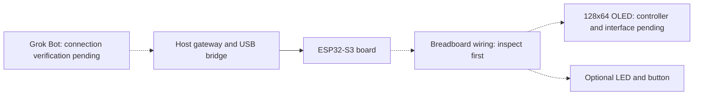

# First physical experiment: ESP32-S3 and OLED

Updated 9 October 2026. **Ordered; not inspected, flashed or physically verified.**
This kit replaces the AtomS3 Lite C124 as the first physical experiment. The ESP32
SDK remains reusable. Existing C124 builds and test records remain valid for that
example only. They do not verify this kit.

## Parts

| Part | Ordered item | Check after delivery |
| --- | --- | --- |
| Board | AYWHP ESP32-S3 DevKitC-style board, ESP32-S3-WROOM-1-N16R8, USB-C | Module marking, board revision, pin labels, USB ports, memory configuration and available LED/button |
| Wiring | ApTechDeals 840-point breadboard and jumper-wire set | Rail continuity, board fit and usable jumper connections |
| Display | Robocraze 0.96-inch 128×64 OLED, advertised as SPI/I²C, 4-pin | Controller, actual interface, pin order, supply rating and bus address |
| USB connection | A USB-C data cable is required; ownership is not confirmed | Data transfer and stable board enumeration |
| Optional output/input | External LED, suitable current-limiting resistor and momentary button, if onboard parts are unsuitable | Select values and wiring after board inspection; these parts are not in the confirmed order |

A four-pin listing does not establish the interface or controller. Do not assume
SSD1306, SH1106, an I²C address or a GPIO assignment. Do not copy C124 GPIO numbers.
Do not treat a reset or boot button as an application input without checking it.

## Demo goal

Ask Grok Bot to show a short message or status on the OLED. Read the reported
state. If a suitable LED and button are available, set the LED and read a button
press. A plain external LED supports on/off; it does not support RGB colour.
Use disconnect, reconnect and restart checks to show when an action is unconfirmed.
The actual Grok Bot route remains a separate verification gate.



## Stage 1: keep simulation first

Run the existing simulator and `grok-gadgets-gateway rehearse`. The current RGB
light/button simulation checks discovery, commands, state, events and recovery.
It does not emulate this OLED or verify the ordered board. Keep its virtual
capabilities explicit; do not present RGB as a feature of the ordered kit.

The ESP32 SDK also provides a separate, controller-independent OLED software
rehearsal. From that repository, run:

```sh
python3 examples/oled-kit/rehearse.py
python3 -m unittest discover -s examples/oled-kit -p 'test_*.py' -v
```

This Python model checks bounded printable ASCII text (up to 32 characters), clear,
logical state, injected button edges, offline errors, reconnect and restart. It
registers no gateway display capability and does not run firmware or a display
driver. Its successful results are software evidence only. A real OLED command
contract, driver and USB/gateway integration remain pending. Simulated button
events do not wake Grok Bot.

## Stage 2: inspect and configure after delivery

1. Record photographs and exact markings of the board and display.
2. Identify the board's USB connector roles and verify the data cable.
3. Find documentation for the delivered revisions. Confirm display supply and
   logic levels, pin order, controller and actual interface.
4. Select free, suitable GPIOs. Check board and module restrictions. Record the
   reviewed wiring table before connecting anything. No fixed pins are specified here.
5. Disconnect power. Check breadboard rails and wire common ground, the confirmed
   supply and the confirmed bus pins. If the module is I²C, record SDA/SCL and
   its observed address; if SPI, document its actual required signals instead.
6. Choose a suitable onboard LED/button or add the optional external parts. Record
   resistor value and button pull configuration. Verify wiring before power-on.
7. Select and build the delivered board configuration. Record USB, flash and PSRAM
   settings. Obtain authorization before flashing. Do not flash a C124 image.
8. Test the display locally with the confirmed driver. Then test through the SDK
   and gateway. Record firmware and source hashes and the host environment.

## Stage 3: acceptance

| Check | Evidence needed | Current state |
| --- | --- | --- |
| Ordered kit identified | Board/display markings and reviewed pin table | Awaiting delivery |
| Local simulation | Tool results, simulated state and recovery evidence | Existing light/button path plus separate OLED Python rehearsal; display integration pending |
| Build for delivered board | Configuration, dependency versions and build log | Pending inspection |
| OLED operation | Requested message/clear action, device report and observed display agree | Pending |
| LED/button, if fitted | Observed output and ordered press/release events | Pending; parts choice not final |
| USB and recovery | Enumeration, offline rejection, reconnect, board/gateway restart and no stale replay | Pending |
| Existing Grok Bot | Actual invocation receipts and independently retrieved execution evidence | Separate gate; pending |
| Independent reproduction | Another person repeats the documented setup | Pending |

Keep command acknowledgement and physical observation separate. Record failures
and skipped steps. Never promote compilation or simulation to hardware verification.
Follow the [physical test procedure](physical-test.md) and the
[connection paths](hosting.md). A Raspberry Pi is not required for this first
ESP32-S3 experiment. Linux peripheral verification remains a separate experiment.
