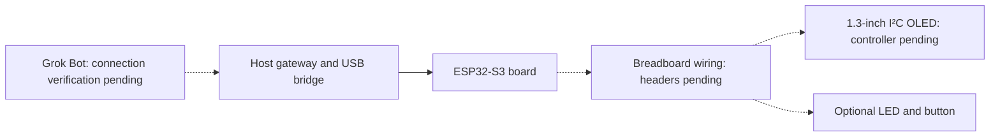
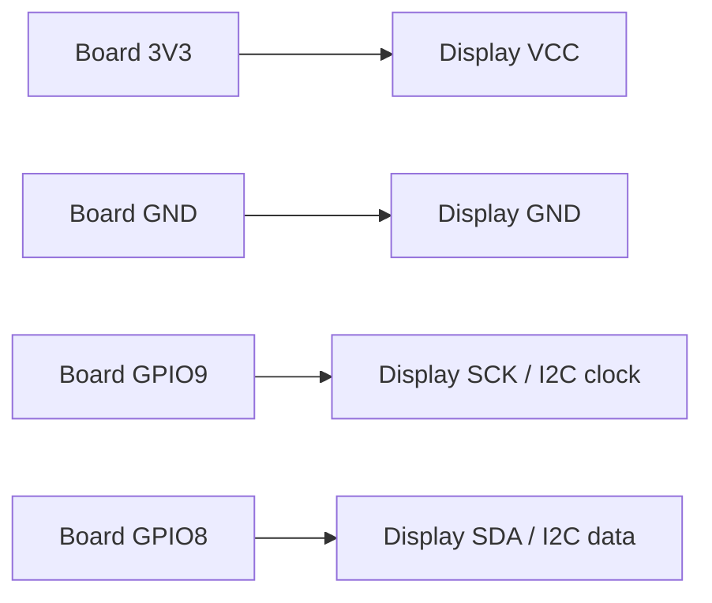

# First physical experiment: ESP32-S3 and OLED

Updated 12 October 2026. **Board and display inspected; USB enumeration observed.
Headers, wiring, firmware and display operation remain pending.** This kit replaces
the AtomS3 Lite C124 as the first physical experiment. Existing C124 builds and
test records apply to that example only.

## Parts

| Part | Delivered and observed | Still to confirm |
| --- | --- | --- |
| Board | YD-ESP32-23 v1.3; module marked ESP32-S3-N16R8; USB-C ports marked `COM` and `USB`; exposed `3V3`, `GND`, GPIO8 and GPIO9 pads; no fitted edge headers | Flash/PSRAM configuration, GPIO electrical checks, reliable headers and firmware |
| Wiring | ApTechDeals 840-point breadboard and jumper wires; loose header pins are available | Solder suitable headers, then check rail continuity and board fit |
| Display | Electrifier 1.3-inch 128×64 I²C OLED; PCB marked `RG1.30 IIC V2.2`; four unpopulated pads labelled `VCC`, `GND`, `SCK`, `SDA` | Controller, I²C address, actual supply and electrical behavior |
| USB connection | The board's `USB` port enumerated on macOS 27.0 as Espressif USB VID `303A`, PID `4001`, with a `/dev/cu.usbmodem*` port | Firmware identity, command transport and unplug/reconnect recovery |
| Optional output/input | External LED, suitable current-limiting resistor and momentary button, if onboard parts are unsuitable | Select values and wiring after board inspection; these parts are not in the confirmed order |

The display PCB establishes its I²C interface and pin labels, but not its
controller or address. Do not assume SSD1306 or SH1106. The [seller listing](https://electrifier.in/product/electrifier-1-3-inch-oled-display-module-128x64-i2c-blue-pack-of-2-two-matched-panels-for-dual-readouts-or-a-ready-spare-3-3v-5v-input-onboard-regulator-4-mounting-holes-each/)
advertises a 3.3–5 V input; use the board's 3.3 V supply for the first test so
the I²C lines stay in the ESP32's 3.3 V domain. Do not copy C124 GPIO numbers.
The visible RGB LED, `BOOT` and `RST` controls are not yet verified as demo
peripherals.

## Demo goal

Ask Grok Bot to show a short message or status on the OLED. Read the reported
state. If a suitable LED and button are available, set the LED and read a button
press. A plain external LED supports on/off; it does not support RGB colour.
Use disconnect, reconnect and restart checks to show when an action is unconfirmed.
The actual Grok Bot route remains a separate verification gate.



## Stage 1: keep simulation first

Run the existing simulator and `grok-gadgets-gateway rehearse`. The current RGB
light/button simulation checks discovery, commands, state, events and recovery.
It does not emulate this OLED or verify the ordered board. Keep its virtual
capabilities explicit; do not present RGB as a feature of the ordered kit.

The ESP32 SDK also provides a separate, controller-independent OLED software
rehearsal. From that repository, run:

```sh
python3 examples/oled-kit/rehearse.py
python3 -m unittest discover -s examples/oled-kit -p 'test_*.py' -v
```

This Python model checks bounded printable ASCII text (up to 32 characters), clear,
logical state, injected button edges, offline errors, reconnect and restart. It
registers no gateway display capability and does not run firmware or a display
driver. Its successful results are software evidence only. A real OLED command
contract, driver and USB/gateway integration remain pending. Simulated button
events do not wake Grok Bot.

## Stage 2: prepare and connect the inspected kit

Both boards arrived without soldered pin headers. Ordinary loose pins held by a
breadboard do not make reliable contact with these holes. Fit and solder straight
2.54 mm headers, or use another mechanically secure, electrically verified
connection, before powering the wired kit. The board's USB-only enumeration
test needed no headers and did not drive the display.

This is the **planned wiring**, read from the printed pin labels. It has not been
connected or powered. `SCK` is the display's I²C clock label (`SCL`). Use **one**
of the two displays.

| Display pad | Board pad | Purpose |
| --- | --- | --- |
| `VCC` | `3V3` | 3.3 V supply; do not use `5Vin` for the first test |
| `GND` | `GND` | Common ground |
| `SCK` | `9` (GPIO9) | I²C clock |
| `SDA` | `8` (GPIO8) | I²C data |



1. Disconnect USB power before fitting headers or moving any wires. Inspect
   solder joints and check the breadboard's actual rail continuity.
2. Connect one display by the **printed labels**, using the table above. Do not
   infer pins from board orientation or jumper colors. Review the finished
   connections before reconnecting USB.
3. Identify the display controller and scan the observed I²C address with
   board-specific firmware. Confirm the delivered board's 16 MB flash and 8 MB
   PSRAM settings before creating and building that firmware.
4. Choose a verified LED/button or fit optional external parts with a suitable
   LED resistor and defined button pull configuration.
5. Obtain authorization for the exact board and firmware image before flashing.
   Then test local text and clear, the SDK and gateway, and recovery. Record
   firmware/source hashes, commands and observed behavior separately.

## Observed USB evidence

On 12 October 2026, the owner supplied photos of the delivered board and display.
The photos establish the markings and visible lack of headers described above;
they are not published in this repository. On macOS 27.0 arm64, a read-only
`ioreg -p IOUSB -w 0` check showed `Espressif Device` after connecting the
board's `USB` port. The USB vendor and product IDs were `0x303A` and `0x4001`.
`ls /dev/cu.*` showed `/dev/cu.usbmodem1234561`. No serial command or flash was
sent. This is a **Pass for USB enumeration only**. The display, I²C address,
driver, firmware and unplug/reconnect recovery are **Not tested**. An earlier
board was not detected; its cause was not diagnosed.

## Stage 3: acceptance

| Check | Evidence needed | Current state |
| --- | --- | --- |
| Delivered kit identified | Board/display markings and planned pin table | Pass for visible markings; controller and electrical behavior pending |
| Local simulation | Tool results, simulated state and recovery evidence | Existing light/button path plus separate OLED Python rehearsal; display integration pending |
| Build for delivered board | Configuration, dependency versions and build log | Not tested; profile and driver pending |
| OLED operation | Requested message/clear action, device report and observed display agree | Pending |
| LED/button, if fitted | Observed output and ordered press/release events | Pending; parts choice not final |
| USB and recovery | Enumeration, offline rejection, reconnect, board/gateway restart and no stale replay | USB enumeration Pass on one Mac; command and recovery checks Not tested |
| Existing Grok Bot | Actual invocation receipts and independently retrieved execution evidence | Separate gate; pending |
| Independent reproduction | Another person repeats the documented setup | Pending |

Keep command acknowledgement and physical observation separate. Record failures
and skipped steps. Never promote compilation or simulation to hardware verification.
Follow the [physical test procedure](physical-test.md) and the
[connection paths](hosting.md). A Raspberry Pi is not required for this first
ESP32-S3 experiment. Linux peripheral verification remains a separate experiment.
