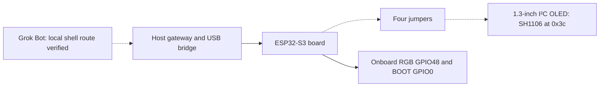
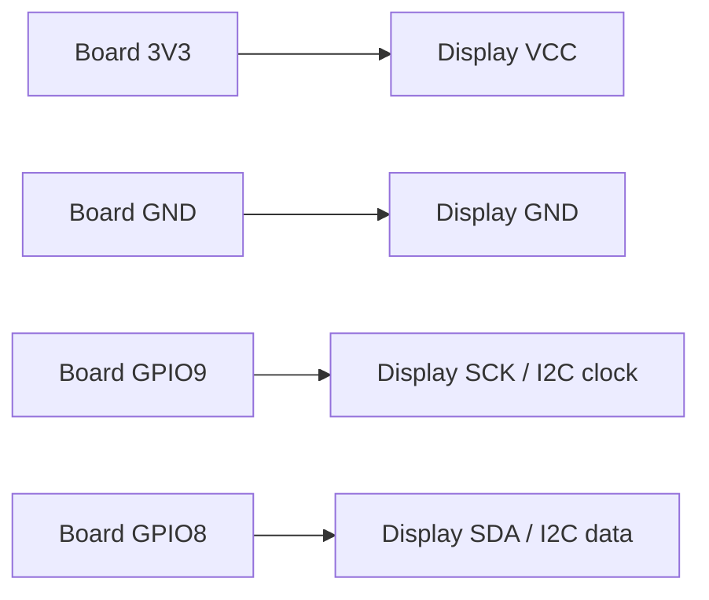

# First physical experiment: ESP32-S3 and OLED

Updated 12 October 2026. **Physical acceptance passed on the owner's kit.** The
[kit firmware](https://github.com/adidshaft/grok-gadgets-esp32-sdk/tree/dev/examples/oled-kit) showed text on the OLED, cleared it, set the RGB light, reported
BOOT presses and recovered from unplug and gateway restart. See the
[verification record](https://github.com/adidshaft/grok-gadgets-esp32-sdk/blob/main/docs/verification/oled-kit-2026-10-12.md). The same day it passed
over Wi-Fi from a USB charger ([Wi-Fi record](https://github.com/adidshaft/grok-gadgets-esp32-sdk/blob/main/docs/verification/oled-kit-wifi-2026-10-12.md)). This covers one kit; nobody else has
repeated it yet. This kit replaces
the AtomS3 Lite C124 as the first physical experiment. Existing C124 builds and
test records apply to that example only.

## Parts

| Part | Delivered and observed | Still to confirm |
| --- | --- | --- |
| Board | YD-ESP32-23 v1.3; module marked ESP32-S3-N16R8 (ESP32-S3 v0.2, 16 MB quad flash); USB-C ports marked `COM` and `USB`; onboard RGB pixel on GPIO48; `BOOT` button on GPIO0 | PSRAM size was not read |
| Wiring | Four jumpers from the board's pins to the display's pins | The passing test did not use the breadboard |
| Display | Electrifier 1.3-inch 128×64 I²C OLED; PCB marked `RG1.30 IIC V2.2`; pins `VCC`, `GND`, `SCK`, `SDA`; **SH1106** controller at I²C address `0x3c` | — |
| USB connection | The board's native `USB` port. Factory firmware enumerates as VID `303A` PID `4001`; the kit firmware as `USB JTAG_serial debug unit` | — |
| Optional output/input | External LED, suitable current-limiting resistor and momentary button, if onboard parts are unsuitable | Select values and wiring after board inspection; these parts are not in the confirmed order |

The display behaved as an SH1106: an SSD1306 driver left a lit column at the right edge.
The kit firmware defaults to SH1106. The [seller listing](https://electrifier.in/product/electrifier-1-3-inch-oled-display-module-128x64-i2c-blue-pack-of-2-two-matched-panels-for-dual-readouts-or-a-ready-spare-3-3v-5v-input-onboard-regulator-4-mounting-holes-each/)
advertises a 3.3–5 V input; use the board's 3.3 V supply for the first test so
the I²C lines stay in the ESP32's 3.3 V domain. Do not copy C124 GPIO numbers.
The RGB pixel and `BOOT` button work as demo peripherals. Never use `RST` as an input.

## Demo goal

Ask Grok Bot to show a short message or status on the OLED through an approved
local command. Read the reported state. Set the onboard RGB light on GPIO48 and
read a press of the BOOT button on GPIO0.
Use disconnect, reconnect and restart checks to show when an action is unconfirmed.
The local-command route passed on the owner's kit. Native MCP calls remain a separate gate.



## Stage 1: keep simulation first

Run the existing simulator and `grok-gadgets-gateway rehearse`. The current RGB
light/button simulation checks discovery, commands, state, events and recovery.
It does not emulate this OLED or verify the physical board. Keep its virtual
capabilities explicit; do not treat its virtual RGB as evidence for the tested kit's onboard RGB pixel.

The ESP32 SDK also provides a separate, controller-independent OLED software
rehearsal. From that repository, run:

```sh
python3 examples/oled-kit/rehearse.py
python3 -m unittest discover -s examples/oled-kit -p 'test_*.py' -v
```

This Python model checks bounded printable ASCII text (up to 32 characters), clear,
logical state, injected button edges, offline errors, reconnect and restart. It
runs no firmware or display driver. Its results are software evidence only; the
separate physical acceptance records cover the real OLED and USB/Wi-Fi routes.
Simulated button events do not wake Grok Bot.

## Stage 2: prepare and connect the inspected kit

Both boards arrived without soldered pin headers. Use a mechanically secure,
electrically reliable connection. Loose jumpers on the breadboard caused repeated USB
resets during the first attempt; jumpers placed directly on the pins worked.

This is the **tested wiring** from the 12 October acceptance. `SCK` is the display's I²C clock label (`SCL`). Use **one**
of the two displays.

| Display pad | Board pad | Purpose |
| --- | --- | --- |
| `VCC` | `3V3` | 3.3 V supply; do not use `5Vin` for the first test |
| `GND` | `GND` | Common ground |
| `SCK` | `9` (GPIO9) | I²C clock |
| `SDA` | `8` (GPIO8) | I²C data |



1. Disconnect USB power before fitting headers or moving any wires. Inspect
   solder joints and check the breadboard's actual rail continuity.
2. Connect one display by the **printed labels**, using the table above. Do not
   infer pins from board orientation or jumper colors. Review the finished
   connections before reconnecting USB.
3. Build and flash the [kit firmware](https://github.com/adidshaft/grok-gadgets-esp32-sdk/tree/dev/examples/oled-kit). From factory firmware, hold `BOOT` while
   plugging into `USB` for the first flash. Restart the board after any rewiring: it
   looks for the display only at startup.
4. Run the gateway and `usb-bridge`, then test text, clear, the RGB light, `BOOT` and
   recovery. Record firmware/source hashes, commands and observations separately.

## Earlier USB inspection, before flashing

On 12 October 2026, the owner supplied photos of the delivered board and display.
The photos establish the markings and visible lack of headers described above;
they are not published in this repository. This paragraph records an earlier step,
not the current kit status. On macOS 27.0 arm64, a read-only
`ioreg -p IOUSB -w 0` check showed `Espressif Device` after connecting the
board's `USB` port. The USB vendor and product IDs were `0x303A` and `0x4001`.
`ls /dev/cu.*` showed `/dev/cu.usbmodem1234561`. No serial command or flash was
sent. This is a **Pass for USB enumeration only**. The display, I²C address,
driver, firmware and unplug/reconnect recovery are **Not tested**. An earlier
board was not detected; its cause was not diagnosed.

## Stage 3: acceptance

Results from 12 October 2026 ([record](https://github.com/adidshaft/grok-gadgets-esp32-sdk/blob/dev/docs/verification/oled-kit-2026-10-12.md)):

| Check | Evidence needed | Result |
| --- | --- | --- |
| Delivered kit identified | Board/display markings and pin table | Pass |
| Local simulation | Tool results, simulated state and recovery evidence | Pass (light/button simulator and OLED Python model) |
| Build for delivered board | Configuration, dependency versions and build log | Pass (`esp32s3-oled-kit`) |
| OLED operation | Requested message/clear action, device report and observed display agree | Pass |
| LED/button | Observed output and ordered press/release events | Pass (onboard RGB pixel and `BOOT`) |
| USB and recovery | Offline handling, reconnect, board/gateway restart and no stale replay | Pass; disconnect during a command not tested |
| Existing Grok Bot | Gateway log plus observed result | Pass through local shell execution; native tool calls not tested |
| Independent reproduction | Another person repeats the documented setup | Pending |

Keep command acknowledgement and physical observation separate. Record failures
and skipped steps. Never promote compilation or simulation to hardware verification.
Wi-Fi acceptance also passed on the owner's kit while it drew power from a USB charger.
The gateway ran on the Mac and used a private LAN TLS listener. See the
[Wi-Fi record](https://github.com/adidshaft/grok-gadgets-esp32-sdk/blob/main/docs/verification/oled-kit-wifi-2026-10-12.md)
and the [repeatable kit guide](repeat-the-kit.md). Follow the [physical test procedure](physical-test.md) and the
[connection paths](hosting.md). A Raspberry Pi is not required for this first
ESP32-S3 experiment. Linux peripheral verification remains a separate experiment.
