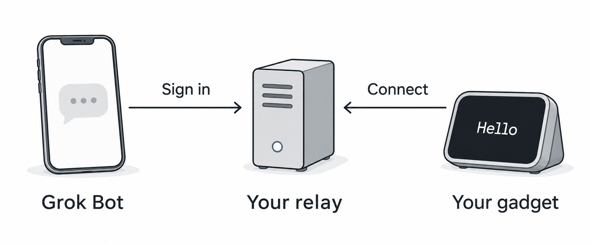

# How it works

Grok Gadgets lets your Grok Bot use small devices: a display, a light, a button. You talk to Grok Bot as usual, and it uses the device for you.

These are the roles:

- **The builder** makes a gadget with our SDKs and gives or sells it.
- **The end user** owns the gadget and talks to their own Grok Bot.
- **Grok Bot** runs the chat and calls the gadget's tools when you ask.

## From your request to the gadget

*Conceptual illustration. The arrows show who starts each connection. Commands and replies then travel in both directions.*

- The gadget connects **out** from the home Wi-Fi to the relay. No router setup and no computer at home.
- Grok Bot connects over HTTPS and signs in to the relay.
- The relay passes Grok Bot's request to the gadget and passes the answer back.

## What each person does

**Builder (once):**

1. Build the gadget with the [ESP32 SDK](https://github.com/adidshaft/grok-gadgets-esp32-sdk) and test it with the simulator.
2. Run one relay for all their gadgets. It is the open-source gateway on a small server.
3. Give each gadget its identity and the relay's address, then ship it.

**End user (once per builder):**

1. Plug in the gadget and join it to home Wi-Fi.
2. Add the builder's address in Grok Bot and sign in once.
3. Claim the gadget with its code, then ask Grok Bot to use it.

A prepared gadget needs no terminal or USB data cable during setup.
See [phone setup](phone-setup.md) and [claim your gadget](claim-your-gadget.md).

## Common questions

**Can the builder's relay see my Grok Bot?**
No. Grok Bot signs in to the relay, not the other way round. The relay only receives the gadget requests that your Grok Bot sends: the device, the command and the device's reported state. It never sees your chats, your account or your Wi-Fi password. You can remove the connection at any time.

**Do I need a special Grok Bot?**
No. You keep the Grok Bot you use every day. The gadgets are one more connection in it, on the phone and on the Mac.

**What if I do not want to use the builder's relay?**
The software is open source. You can run your own relay for your own gadgets. The [Mac-free route guide](mac-free-route.md) shows how.

**I own gadgets from four builders. Do I need four apps?**
No. Add each builder's address to Grok Bot once and sign in once for each. Then one Grok Bot chat can use all of them: "dim the lamp and show the weather on the desk display". This is the design; so far one gadget server has been tested.

**What happens if the relay is down?**
Grok Bot tells you it cannot reach the gadget. Nothing is queued. The gadget shows `Relay...` and reconnects by itself when the relay is back.

**Can a button on the gadget start a Grok Bot chat?**
No. Button presses wait on the relay until Grok Bot reads them.

## What the evidence shows

| Evidence | Result | Still open |
| --- | --- | --- |
| Clean-room software run | A fresh relay, Linux gadget batch and scripted sign-in passed the builder guide. | This does not prove physical operation or a real Grok Bot call. |
| Owner hardware run | On a fresh relay, the owner set up the OLED kit, claimed it and used Grok Bot to show text. A signed update also passed. | The climate sensor, switch and servo examples need their own hardware tests. |
| Builder outside the project | No report yet. | Someone outside the project must follow the public guide ([#269](https://github.com/adidshaft/grok-gadgets/issues/269)). |

The [builder record](https://github.com/adidshaft/grok-gadgets/blob/main/docs/verification/builder-kit-2026-10-17.md) keeps the software and owner results separate.
See [project status](../public/support-matrix.md) for current releases and the full verification history.

## Choose your next step

- Have a prepared gadget? [Set it up with your phone](phone-setup.md), then [claim it in Grok Bot](claim-your-gadget.md).
- Building for someone else? [Ship a gadget in one afternoon](ship-a-gadget.md).
- Want the server details? [Run the gateway away from your Mac](mac-free-route.md).
