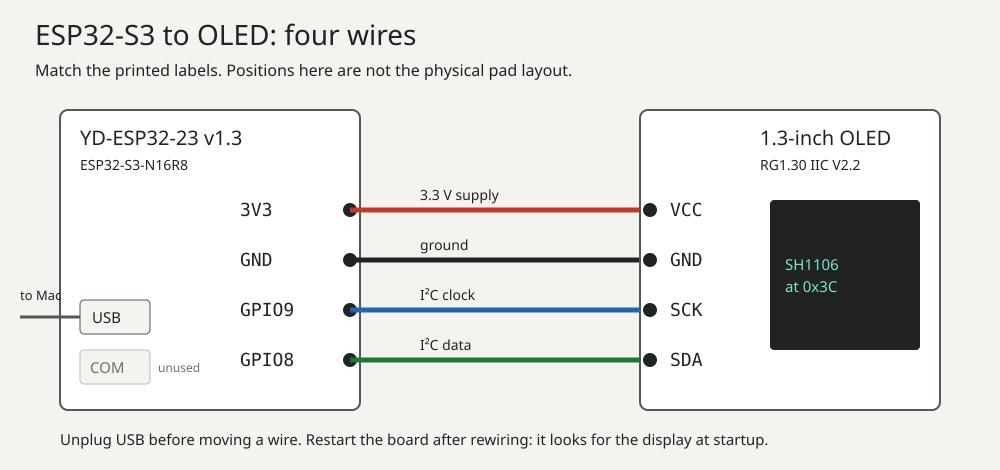

# Repeat the ESP32-S3 OLED setup

Use this guide to repeat the owner's 12 October 2026 setup. It covers one
YD-ESP32-23 v1.3 board with an ESP32-S3-N16R8 module and one 1.3-inch SH1106
OLED at I²C address `0x3C`. The owner passed USB and Wi-Fi acceptance with this
kit. Your results are new evidence; do not assume your board will pass.

Use the released [ESP32 SDK v0.2.0-alpha.18](https://github.com/adidshaft/grok-gadgets-esp32-sdk/releases/tag/v0.2.0-alpha.18)
and [gateway v0.1.0-alpha.17](https://github.com/adidshaft/grok-gadgets-gateway/releases/tag/v0.1.0-alpha.17).
Firmware binaries are not published. Build the firmware from source.
For signed updates after setup, follow [Sign and ship an update](sign-and-ship-an-update.md).
That guide adds your public signing key to the first image. Keep the private key off the relay.

## Before you start: install the gateway and get the firmware

You need a Mac or Linux computer with Git and Python 3.11 or later. Install the
released gateway in a virtual environment. Clone the ESP32 SDK at its release
tag to build the firmware; binary firmware is not published. Git reports a
"detached HEAD" for a tag; that is expected. Run the following from a new
working directory and return to that directory before gateway commands.

```sh
python3 -m venv .venv-gateway
.venv-gateway/bin/python -m pip install grok-gadgets-gateway==0.1.0a17
.venv-gateway/bin/grok-gadgets-gateway --version
git clone --branch v0.2.0-alpha.18 https://github.com/adidshaft/grok-gadgets-esp32-sdk.git
cd grok-gadgets-esp32-sdk
python3 -m venv .venv
.venv/bin/pip install -r requirements.lock
.venv/bin/pio pkg install
cd ..
```

The `--version` command prints `grok-gadgets-gateway 0.1.0a17`. The first PlatformIO run
downloads the ESP32 toolchain, which takes several minutes.

## 1. Check the parts

- Check that the board says `YD-ESP32-23` and `v1.3`. Check the module marking
  `ESP32-S3-N16R8`.
- Check that the OLED says `RG1.30 IIC V2.2` and has `VCC`, `GND`, `SCK` and
  `SDA` pads. This guide uses the SH1106 controller.
- Use a USB-C data cable for flashing and provisioning. Use the board's native
  **USB** port, not **COM**. Use a 2.4 GHz Wi-Fi network for the wireless run.

Disconnect USB power before you move a wire. Use a secure connection. The
delivered boards had no fitted pin headers; loose jumpers caused resets during
the owner's first attempt. The passing test used jumpers directly on the pins.

| OLED pad | Board pad |
| --- | --- |
| `VCC` | `3V3` |
| `GND` | `GND` |
| `SCK` | GPIO9 |
| `SDA` | GPIO8 |



The onboard RGB light uses GPIO48. The BOOT button uses GPIO0. Check printed pad
labels; do not infer pin position from a photo or wire color.

## 2. Flash and check USB

In the ESP32 SDK checkout, build and flash the Wi-Fi build. Use
`esp32s3-oled-kit` instead for a USB-only run.

```sh
.venv/bin/pio run -e esp32s3-oled-kit-wifi
.venv/bin/pio run -e esp32s3-oled-kit-wifi -t upload
```

For the first flash, hold BOOT while you connect the cable to **USB**, then release it.
See the kit's [README](https://github.com/adidshaft/grok-gadgets-esp32-sdk/blob/v0.2.0-alpha.18/examples/oled-kit/README.md)
for the commands and status messages.
Restart the board after you change any display wire. The firmware checks for the
OLED at startup.

For a USB run, start the gateway and its USB bridge by following the
[gateway kit guide](https://github.com/adidshaft/grok-gadgets-gateway/blob/v0.1.0-alpha.17/docs/experiment-kit.md).
That source guide uses `uv run` in a contributor checkout; from this working
directory use `.venv-gateway/bin/grok-gadgets-gateway` instead.
Check a short `display.text` command, `display.clear`, the RGB light, a BOOT
press and recovery after unplugging and reconnecting. Record the command reply
and what you saw on the board as separate results. A reply does not prove a
physical effect.

## 3. Provision and check Wi-Fi

For Wi-Fi, use the ESP32 SDK's `esp32s3-oled-kit-wifi` build. Follow the
[Wi-Fi devices guide](https://github.com/adidshaft/grok-gadgets-gateway/blob/v0.1.0-alpha.17/docs/wifi-devices.md)
for the detailed command responses. Use the installed gateway path from this guide.
Use the Mac's mDNS name, so the setup keeps working when the Mac's address changes. On
macOS, `scutil --get LocalHostName` prints the name; add `.local`, in lower case. The
steps below write it as `my-mac.local`. You can use the Mac's IPv4 address instead, but
then a new address means a new certificate and provisioning the board again.

1. Run `.venv-gateway/bin/grok-gadgets-gateway init` and `.venv-gateway/bin/grok-gadgets-gateway lan-cert my-mac.local`.
2. Run `.venv-gateway/bin/grok-gadgets-gateway enroll DEVICE` once. Use the same device ID that
   the board reports: `oledkit-` and the board's MAC address in lower case without
   colons. The flash log prints the MAC. The serial console also replies to
   `{"type":"status"}` with the device ID.
3. Stop the USB bridge. Run `.venv-gateway/bin/grok-gadgets-gateway wifi-provision PORT --device
   DEVICE --lan my-mac.local` while the board is on the USB data cable. Type
   the Wi-Fi name and password at the local prompts. Do not paste them into a
   public issue or log.
4. Start `.venv-gateway/bin/grok-gadgets-gateway serve --lan-listen my-mac.local`. Move the
   board to a USB charger. Wait for **Online** on the OLED.
5. Send a short text command and clear it. Press and release BOOT. Turn the
   router off and on, then check that the board returns to **Online**. Restart
   the gateway and check it again.
6. Keep it running: stop `serve` (Ctrl-C), then run
   `.venv-gateway/bin/grok-gadgets-gateway service install --lan-listen my-mac.local`. The gateway
   now starts at every login, with no terminal. See
   [Keep the gateway running](https://github.com/adidshaft/grok-gadgets-gateway/blob/v0.1.0-alpha.17/docs/always-on.md).

Check `.venv-gateway/bin/grok-gadgets-gateway service status` after login. On the
owner's Mac the board returned Online after about 90 seconds in one restart
run; faster startup is still being checked. Use `service logs` for diagnostics
and `service uninstall` to stop automatic starts. Keep this working directory
and virtual environment in place while the service is installed.

The board uses a pinned local CA certificate and a device token. It stores the
Wi-Fi password and token in flash without encryption. If the board is lost,
revoke its token and change the Wi-Fi password. Do not forward the LAN listener
port on your router or put it behind a tunnel.

Holding BOOT for 10 seconds erases the board's Wi-Fi settings. The display
counts down after 3 seconds. Release BOOT before zero to keep the settings.

## 4. Optional: ask Grok Bot

With the gateway running, ask Grok Bot in its desktop app to run an approved
local command using the absolute path to the installed gateway. Replace `DEVICE`
with the enrolled board ID:

```sh
/absolute/path/to/.venv-gateway/bin/grok-gadgets-gateway rehearse --device DEVICE --command display.text --args '{"text":"Hello from Grok Bot"}'
```

This uses **Execution on Local Computer**. Approve the command when Grok Bot asks. Set that
permission to ask every time, not always allow; the owner's setting was **Always
allow**, so no approval card appeared. Check the gateway request log and the OLED.
For native tool calls from the desktop and phone apps, see
[Connect your Grok Bot](connect-grok-bot.md).

## 5. Record the result

Copy this table into [tester issue #185](https://github.com/adidshaft/grok-gadgets/issues/185).
Remove private addresses, Wi-Fi names, tokens, passwords, serial numbers and
household details before posting.

| Item | Your result |
| --- | --- |
| Board and OLED markings | |
| ESP32 SDK and gateway release tags | |
| Firmware build and SHA-256 | |
| Host OS and connection type | |
| OLED text and clear: reply / observation | |
| RGB and BOOT: reply / observation | |
| USB disconnect and recovery | |
| Wi-Fi online and recovery, if tested | |
| Failed or skipped checks | |

The owner's [USB record](https://github.com/adidshaft/grok-gadgets-esp32-sdk/blob/main/docs/verification/oled-kit-2026-10-12.md)
and [Wi-Fi record](https://github.com/adidshaft/grok-gadgets-esp32-sdk/blob/main/docs/verification/oled-kit-wifi-2026-10-12.md)
show the evidence level to use. In the owner's setup Grok Bot ran an approved local
command and, through the remote route, called the tools natively.

## Troubleshooting

These come from the owner's USB and Wi-Fi tests on 12 October 2026.

| What you see | Try this |
| --- | --- |
| No `/dev/cu.usbmodem*` port, or the first flash fails | Use a data cable on the **USB** port. Hold BOOT while you plug in, then flash. After the kit firmware is on the board, later flashes reset it without buttons. |
| Flash says the port is busy | Stop `usb-bridge` first. The port name changes when you use another Mac port; run `ls /dev/cu.usbmodem*` again. |
| The board resets again and again | Loose jumpers on the breadboard caused this. Put the jumpers directly on the pins, or solder headers. |
| Blank OLED | Check the four wires against the table, then restart the board. The firmware looks for the display only at startup. |
| A lit column at the right edge | The firmware was built for an SSD1306. This display is an SH1106; use the default build. |
| **Not provisioned** | The board has no Wi-Fi settings, or BOOT was held for 10 seconds. Run `wifi-provision` again. |
| **WiFi...** stays on | The board is still trying to join. Within about 20 seconds the top row shows a reason. |
| **No network** / **2.4GHz? Name?** | The board cannot see the network. Use a 2.4 GHz network; the ESP32-S3 has no 5 GHz radio. Type the Wi-Fi name exactly, including upper and lower case, and run `wifi-provision` again. |
| **Wrong password** / **Check password** | The network refused the password. Run `wifi-provision` again with the right password. |
| **Join timeout** / **Check router** | The network did not answer. Check that the router is on and the board is in range. |
| `wifi-provision` says "The device did not answer" | Use the Wi-Fi build on the **USB** port and stop `usb-bridge`. With `v0.2.0-alpha.10` or later, a provisioning line no longer restarts the board. |
| **Gateway name?** | The board cannot find the Mac by name. Check that the Mac is on, awake and on the same network. Some guest or mesh networks block mDNS; then provision with the Mac's IPv4 address. |
| **Gateway...** for a minute after the Mac restarts | The gateway service is still starting. Wait; the board connects without help. `.venv-gateway/bin/grok-gadgets-gateway service status` shows whether it runs. |
| **Gateway...** stays on | Wi-Fi works, but the gateway does not answer. Check `.venv-gateway/bin/grok-gadgets-gateway service status`, or run `serve --lan-listen` in a terminal. If you provisioned an IPv4 address and the Mac's address changed, run `lan-cert` for the new address and provision the board again, or switch to the Mac's `.local` name. |
| **TLS rejected** | The board does not trust the gateway's certificate. Use the certificate from the same `init`, or provision the board again with the current CA. |
| **Token rejected** | The device token was revoked or rotated. Run `enroll DEVICE --rotate`, then `wifi-provision` again. |
| Grok Bot ran a command without asking | Its local execution permission is set to always allow. Change it to ask every time. |
