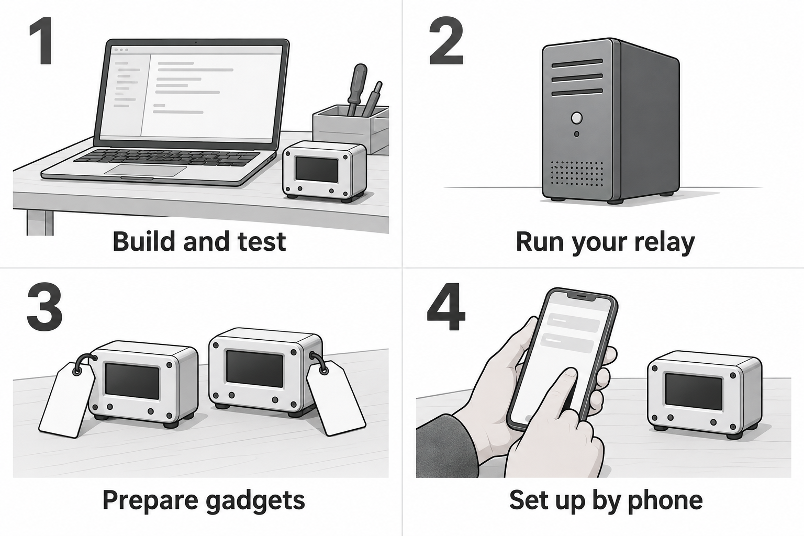

# Ship a gadget in one afternoon

Use this guide to set up your relay, prepare gadgets, and hand them to people who use Grok Bot.
Each step links to the guide with the detail.

**Tested with the owner's OLED kit and two Linux gadgets.** A builder outside the project has not repeated this guide yet.

| Evidence | What passed |
| --- | --- |
| Clean-room software run | Relay setup, Linux batch, scripted sign-in, account checks and update rehearsals. |
| Owner hardware run | Fresh relay, phone setup, screen-code claim, Grok Bot display command and signed firmware update. |
| Outside builder | Still open: [report a repeat run in #269](https://github.com/adidshaft/grok-gadgets/issues/269). |

See the [dated results](https://github.com/adidshaft/grok-gadgets/blob/main/docs/verification/builder-kit-2026-10-17.md) and [builder decision](../decisions/013-builder-kit.md).

Read [Before you distribute a gadget](before-you-distribute.md) before you give or sell one.



Conceptual sequence, not photographs of tested hardware.
Build and test your application, run a relay, prepare each gadget, then help its owner set up and claim it.

## What you need

- A computer with Python 3.11 or later and `uv`.
- A small Linux host, for example a VPS with 512 MB of memory and Ubuntu 24.04.
- A domain where you can add DNS records, and a tunnel account for one name.
- ESP32-S3 boards with your parts, a USB data cable, or Linux machines for Linux gadgets.
- Grok Bot on your phone or desktop.

Install the tested gateway on your computer: `uv tool install grok-gadgets-gateway==0.1.0a21`.
For Linux gadgets, use Linux SDK `0.1.0a10`. For ESP32 boards, use ESP32 SDK `v0.2.0-alpha.19`.
See [current releases](../public/support-matrix.md#current-releases) before you choose another version.

## 1. Choose a template

- **ESP32:** copy `examples/template` from the
  [ESP32 SDK](https://github.com/adidshaft/grok-gadgets-esp32-sdk). The climate sensor, the
  switch and the servo examples show more patterns. These examples compile and pass host tests; hardware checks remain open.
- **Linux:** start from the decorator example in the Linux SDK's
  [development guide](https://github.com/adidshaft/grok-gadgets-linux-sdk/blob/main/docs/development.md).

Name your commands and events from the [capability vocabulary](capability-vocabulary.md).
Write one clear sentence for each: Grok Bot reads it.

## 2. Test without hardware

```sh
grok-gadgets-gateway serve --simulator      # in one terminal
grok-gadgets-gateway rehearse               # in another
```

`rehearse` calls the gateway tools with a local client. This is software evidence; it does not verify Grok Bot. A Linux gadget runs on your computer
with `grok-linux-agent dev ./my_gadget.py`.

## 3. Set up your relay

```sh
grok-gadgets-gateway relay init --mcp-host gadgets.example.net \
  --device-host devices.example.net --out my-relay
```

Follow `my-relay/NEXT-STEPS.md`: create the host with `cloud-init.yaml`, add a DNS-only record
for the device name, and connect the tunnel for the Grok Bot name. Then connect your own
Grok Bot and approve its sign-in on the host: this is your `operator` account. Run the
preflight from your computer. Every line must start with `ok`:

```sh
grok-gadgets-gateway relay-check devices.example.net --ca relay-ca.pem \
  --mcp https://gadgets.example.net/mcp
```

Detail: [Run the gateway away from your Mac](mac-free-route.md) and the gateway's
[relay host guide](https://github.com/adidshaft/grok-gadgets-gateway/blob/main/docs/relay-host.md).

## 4. Create your signing key

```sh
grok-gadgets-gateway firmware keygen --out ~/grok-gadgets-keys/builder.key
```

Back up the private key offline. Build every ESP32 image with the public key, so you can send
fixes later without a cable. Detail: [Sign and ship an update](sign-and-ship-an-update.md).

## 5. Prepare a batch

For ESP32 boards:

1. Build and flash each board over USB with `GROK_UPDATE_PUBLIC_KEY` set.
2. Read each board's ID: `grok-gadgets-gateway factory-provision PORT --read-id`.
3. List the IDs in `ids.csv` (one `device_id` column) and, on the relay host, run
   `grok-gadgets-gateway enroll --batch ids.csv --out batch-1`. Copy the folder to your
   computer, privately.
4. For each board: `grok-gadgets-gateway factory-provision PORT --gateway devices.example.net
   --ca relay-ca.pem --batch batch-1`. Stick its printed label on it. A board that was
   provisioned before needs `--replace`, and it keeps its old Wi-Fi: hold BOOT for 10 seconds
   before you hand it over.

For Linux gadgets:

1. On the relay host, run
   `grok-gadgets-gateway enroll --count 3 --prefix lamp- --out batch-2 --no-labels`.
   Copy the folder to your computer, privately.
2. Run each gadget with its own ID and token file. `--device-id` replaces the ID in your
   factory, so one factory serves the whole batch:

   ```sh
   grok-linux-agent --factory-file ./my_gadget.py --device-id lamp-01 \
     --gateway devices.example.net --ca relay-ca.pem \
     --token-file batch-2/tokens/lamp-01.token --retry-forever
   ```

3. A Linux gadget has no claim code. Give it to an account on the relay host: find the
   account with `grok-gadgets-gateway accounts list`, then run
   `grok-gadgets-gateway accounts assign lamp-01 ACCOUNT`. The account is yours (`operator`)
   or that of a person who claimed another gadget.

Detail: [Factory-provision and label a gadget](factory-provision.md) and the ESP32 SDK's
[Ship a gadget](https://github.com/adidshaft/grok-gadgets-esp32-sdk/blob/main/docs/ship-a-gadget.md).

## 6. Hand over and check

1. The person joins the gadget to home Wi-Fi with a phone and the label:
   [Set up your gadget with your phone](phone-setup.md).
2. They add your relay in Grok Bot and claim the gadget with its code. A display shows the
   code; a gadget without one shows it on the setup page. See
   [Claim your gadget](claim-your-gadget.md). A Linux gadget comes to its account from you
   (step 5).
3. They ask Grok Bot to use it.
4. You check every gadget on the relay host: `grok-gadgets-gateway builder report`.

## 7. Keep it running

- Send fixes: [Sign and ship an update](sign-and-ship-an-update.md). Owners read
  [Keep your gadget up to date](keep-up-to-date.md).
- Moving a gadget to a new owner: [Hand a gadget to someone](hand-a-gadget-to-someone.md).
- Keep the relay host updated, and keep the key and the backups safe.
