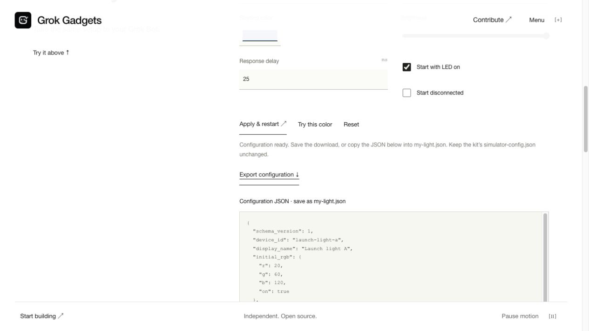

# Visual sources and evidence

Original project vectors, created from maintained architecture and board records. Each flow has an editable `.mmd` source; SVG cards provide an accessible static explanation rather than a runtime-dependent diagram. Read order follows the visible numbers. The contribution and no-hardware sequences are ordered; the responsibility map lists separate owners.

The overview lists the browser, export, kit, gateway and SDK software. Grok native receipts, the authenticated cloud-to-local route and real Home Assistant remain separate pending paths; Home Assistant can connect directly to Grok using upstream MCP. The command lifecycle ends with a distinct physical observation that cannot be inferred from an ACK.

[ESP32-S3 kit reference](esp32-s3-kit-reference.svg) illustrates the inspected YD-ESP32-23 v1.3 board with ESP32-S3-N16R8.
It includes the ApTechDeals 840-point breadboard, jumper wires, and Electrifier 1.3-inch 128×64 I²C OLED marked RG1.30 IIC v2.2. The display pads are labeled VCC, GND, SCK and SDA. The board's native USB port enumerated on a Mac. The display is an SH1106 at I²C address 0x3c. This illustration is not a wiring guide; see the getting-started hardware guide for the tested wiring table. The current light simulator does not prove OLED operation.

[ESP32-S3 to OLED wiring](esp32-s3-oled-wiring.svg) shows four connections that passed on the owner's kit on 12 October 2026.
They are 3V3 to VCC, GND to GND, GPIO9 to SCK and GPIO8 to SDA.
The Mac connects to the board's USB port. It shows connections by printed label, not physical pad positions.

This screenshot was captured from the running local website on 5 October 2026, with the actual customization/export panel open. It shows software simulation only, no account information or physical device. The exported `my-light.json` document was saved from the visible JSON fallback; a browser download-event capture timed out. SHA256 of the image: `c3215addc08a33a6d12b72727f9a034ca96c2743bd1ad26159bac70ac39a7dd2`. [Community artwork provenance](brand-provenance.md) distinguishes original artwork from third-party reference marks.

## Builder illustrations

[Relay route](relay-route-concept.png) is a conceptual illustration for the current relay guide, added on 18 October 2026.
It shows connection initiation: Grok Bot signs in to the relay, and a Wi-Fi gadget connects outbound.
Commands and replies use those connections in both directions.
The illustration is not a product photograph, wiring guide or verification record.
The adjacent guide text gives the same explanation without the image.
Image hashes and publication paths are in `website/documents.json`.

[Builder steps](builder-steps-concept.png) shows four stages: build and test, run the relay, prepare gadgets, and set up by phone.
It is a conceptual sequence, not photographs or evidence that a board example passed hardware checks.
The builder guide provides the text equivalent and separates software tests from owner observations.
